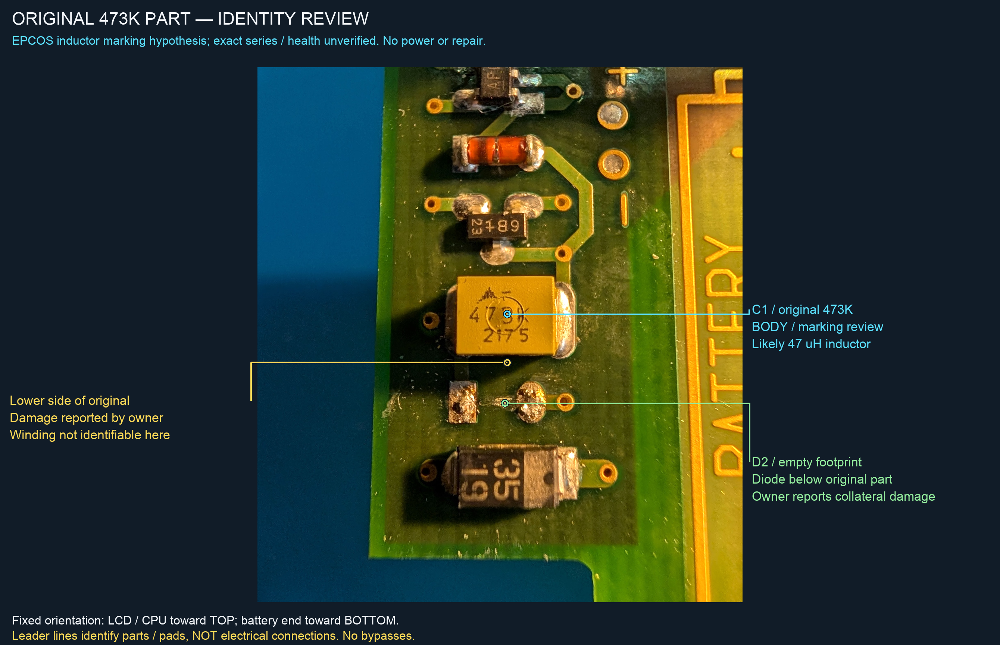
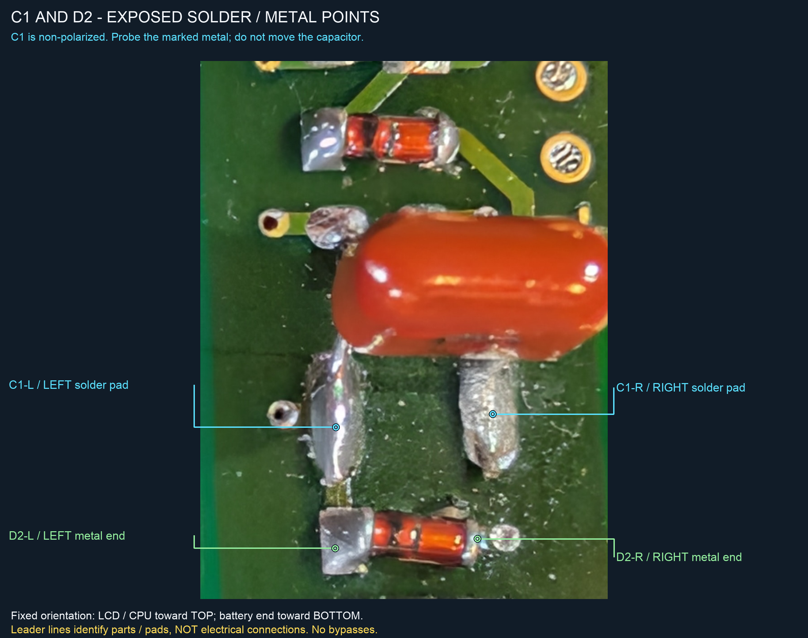

# Case study: battery damage and a misidentified boost inductor

[Home](../README.md) · [Hardware reference](../docs/board-atlas.md) · [Measurement tables](../docs/measurements.md)

## Outcome and scope

On one Siemens 3RK1904-2AB02, replacing an incorrectly fitted **47 nF film capacitor** with a **47 µH inductor** restored input-powered UI startup and produced an MCU rail near **5.06 V from about 4.10 V at the converter input**. Electrical manual OFF subsequently reduced LOGIC to 0.01 V.

That is evidence of restored boost action and an OFF response—not a verified complete repair. The initial battery-overheating cause, repeated wake, idle auto-OFF, full battery/HV operation, ripple and AS-i functions remain unverified.

## 1. Original damage and early repair

The owner reported battery leakage, fresh-cell overheating, a corroded third-cell positive contact/via, and damage around the yellow part later labelled C1 and the diode beneath it, D2. The contact/via was repaired with a wire. C5/C6 were reported failed and replaced with 100 µF / 50 V parts; C2–C4 were also replaced, but their exact original/replacement values were not supplied. D2 was replaced with a BAS85 according to the owner's order/packet.

The yellow part was initially treated as a capacitor because **473K** was interpreted using a capacitor code. A 47 nF film capacitor was fitted at C1. The unit still did not operate from its battery supply.



This historical photograph retains the original part. The owner reported lower-side damage and collateral damage to D2; the winding is not identifiable here. The exact original diode type and initiating failure mechanism were not established.

## 2. Separating UI operation from the incoming power path

With the film capacitor installed, battery-only measurements showed C6+ around 4.7 V but MCU near **0.78 V** and LOGIC near **0.01 V**, with no functioning UI.

In a different historical setup, with all AA cells removed, direct 4.50 V MCU-rail supply allowed LCD operation. MCU measured 4.475 V and LOGIC 4.396 V ON; after manual OFF, LOGIC fell to 0.0134 V. This showed that much of the UI/control circuitry could work when the failed incoming path was bypassed. It did **not** demonstrate a working converter.

Device identification also corrected an early assumption: the pair near C5 was not two NPN transistors. Q2's YBs marking matched a **BSS84P P-MOSFET**, while Q3's 2Gs marking matched **BC850C**. Their historical voltages fitted a switched MCU-to-LOGIC rail.

## 3. Reconstructing the boost stage

Continuity established the following local structure:

```text
C6+ -- C1 location -- Q1 collector / D3 anode
                                    |
                           D3 cathode -- MCU / C5+

Q1 emitter = GND
AF drive -- 2.2 kΩ RA-B -- Q1 base
```

AF's marking **AF0S**, package and all five mapped connections strongly matched the **Torex XC6367A501MR**, a 5 V / 100 kHz external-transistor step-up controller. Its application circuit requires an inductor feeding the collector/diode junction.

The installed series film capacitor could not provide the required continuous DC input path. The blue axial parts on the reverse face were resistors, not a substitute input inductor. Neither an assumed parallel feed nor an unsupported charge-pump explanation resolved the discrepancy.

## 4. Rechecking the original part, not its replacement

The historical photograph's package/logo/marking strongly matched the **EPCOS SIMID inductor family**. The manufacturer marking convention uses nanohenries:

```text
473 = 47 × 10³ nH = 47 µH
K   = ±10% tolerance
```

The reported original resistance, about **1.8 Ω both ways**, was compatible with winding resistance for one documented candidate, rather than proof of a shorted capacitor. It did not prove the damaged original healthy. The approximately 51 nF result obtained earlier measured the **film replacement**, not the removed original.

Two manufacturer examples narrowed the possibilities without identifying the exact Siemens part:

| Candidate example | Approximate body | Rated current | Maximum DCR |
|---|---|---:|---:|
| B82432-A1473-K / 1812-A | 4.5 × 3.2 × 3.2 mm | 210 mA | 2.3 Ω |
| B82442-A1473-K / 2220-A | 5.6 × 5.0 × 5.0 mm | 340 mA | 0.68 Ω |

Owner-reported pads of 1.5 × 4 mm at 4.5 mm centers favored the 1812-A footprint, assuming the stated pad direction. This narrowed package size, not the exact original SKU. The removed original was not available for new testing.

## 5. Correcting the substitution

The owner installed **Electrokit 41000071**, matching the linked **Fenghua LGA0410-470** axial-inductor row: 47 µH ±10%, 340 mA rating, 1.22 Ω maximum DCR, 6.3 MHz minimum self-resonance, approximately Ø4 × 10.5 mm. The red film capacitor was removed, not retained in parallel.

This was a controlled electrical substitute, **not a physical drop-in or confirmed factory-equivalent part**. The axial body requires insulated mechanical support, short leads and no strain on the original pads. Its current rating does not establish measured peak-current margin.



**Historical image only:** this shows the removed film capacitor, not the axial-inductor repair. Its embedded use of “capacitor” describes the then-fitted wrong part. The C1-L/C1-R labels identify stable PCB pads. Do not use this view as an assembly instruction.

## 6. Input-powered results after the correction

On **20 October 2026**, the owner reported startup using only PSU positive at the three-cell tap and negative at pack negative: 4.50 V setting / 20 mA limit, all four AA cells removed, AS-i unplugged and no MCU bypass.

The completed measurements gave actual PSU **4.49 V**, D2 input **4.47 V**, C6+ **4.10 V** and MCU **5.063 V**. The supply indicated CC; the UI was reported stable at the first ON position, with no recorded stop/reset/drift/restart event.

The next documented run used the same input-only arrangement with a **30 mA limit**. It settled in CV at a displayed **0.016 A**, with C6+ **4.0963 V**, MCU **5.062 V** and LOGIC **5.01 V**. After manual OFF, LOGIC fell to **0.01 V** and MCU moved toward **4.04 V** while C6+ rose toward **4.29 V**.

Output above input provides stronger evidence for boost action than UI startup alone, which might otherwise occur through a passive feed. MCU remaining nonzero OFF is consistent with passive inductor/diode conduction when switching stops.

The OFF current field omitted its unit and ended at 0.003, inferred to be amperes from context. The later worksheet's LCD-description and notes fields were blank. No precise shutdown timing, fresh LCD message, calibrated standby drain or captured transient is inferred from them.

## 7. What this case establishes—and what it does not

**Supported:** the wrong replacement interrupted the expected inductive input path; restoring 47 µH enabled input-powered near-5 V boost operation in the limited test setup, followed by an electrical LOGIC-off response.

**Not established:** the original damaged inductor's exact identity/condition, the original June overheating mechanism, all component health, repeat wake/idle behavior, durable mechanical/thermal repair, full battery operation, the separate HV branch or complete AS-i functionality. The prepared next wake/idle worksheet contained no results.

The transferable lesson is not “replace this part in every dead unit.” It is to **identify the original component using manufacturer evidence and circuit topology before choosing a replacement**, and to keep bypass success separate from repaired normal-path operation.

See [identification pitfalls](../docs/identification-pitfalls.md), [safety](../docs/safety.md) and [datasheet sources](../docs/sources.md).
