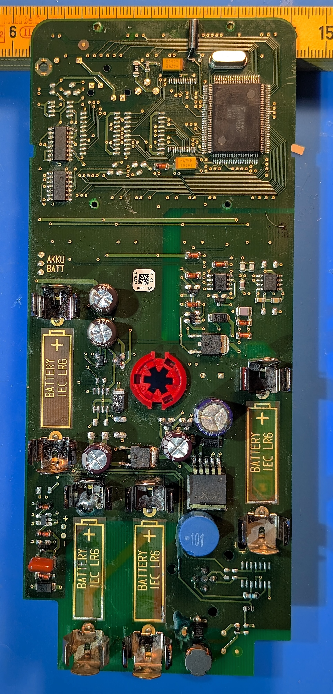
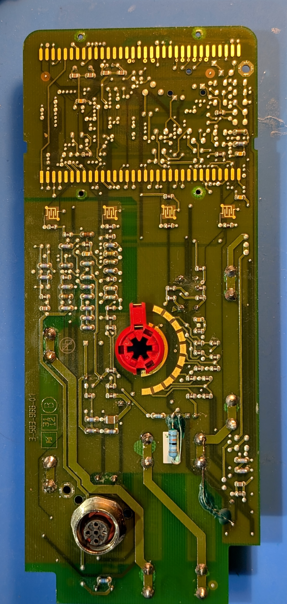

# Board atlas

[Home](../README.md) · [Components](components.md) · [Power architecture](power-architecture.md)

## Orientation and labels

- **TOP:** LCD contacts / Toshiba processor.
- **BOTTOM:** battery terminals.
- **Side B:** component face. **Side A:** reverse face.
- Left/right are as seen on that face. Turn the board over while keeping the battery end down; the photographs are not mirrored.
- Reference names are documentation labels, not factory silkscreen designators.

The photographs show earlier investigation states, including replacement capacitors and, in some views, the **incorrect red film capacitor at C1**. Use them for location, not as an original-parts inventory or an assembly guide. A photograph of the subsequently installed 47 µH axial inductor is not available in this selection.

## Full-board views

### Side B — component face

Upper area: CPU and crystal on the right, 74HC02/74HC123 on the left, C8/C9 beside the CPU. Middle: MC34072 and ICM7555 above/right of the selector, C5/C6 and Q2/Q3 to its left. Lower area: AF/Q1/C1/D2 repair strip at the left; J327, LM2577 and the blue inductor farther right.

### Side A — reverse face

The two R51 resistors are near the selector. RA-T/RA-M/RA-B are a **different** group behind the repair corner. Rear electrolytic-joint labels are fixed physical locations, not source-voltage assumptions.

## Selected detail views

| Area | Figure | What it establishes visually |
|---|---|---|
| C5/C6 and Q2/Q3 | [Capacitors and pair](../assets/figures/capacitors-and-pair.png) | C6 above C5; Q3 left, Q2 right; C7 below |
| Q2/Q3 terminals | [Pair pin map](../assets/figures/q2-q3-pins.png) | Separate physical terminals and matched device pin roles |
| AF, Q1 and D3 | [Repair-corner pin map](../assets/figures/af-q1-pins.png) | Custom AF point positions and Q1/D3 metal terminals |
| R51 pair | [Reverse resistor map](../assets/figures/r51-resistors.png) | Each 51 kΩ resistor and rear capacitor joints |
| Local base-drive resistor | [Reverse passive ends](../assets/figures/reverse-passive-ends.png) | RA-B beneath the two blue axial resistors |
| C7 | [Exposed leads](../assets/figures/c7-leads.png) | Actual metal leads, not a body-only locator |
| C8/C9 | [CPU capacitors](../assets/figures/cpu-capacitors.png) | Distinct capacitor terminal locations |
| U1 | [Marking and pinout match](../assets/figures/u1-max4162.png) | +AABX and MAX4162 matched pin roles; source rotated 180° |
| U2/U3 | [Transistor terminals](../assets/figures/u2-u3-pins.png) | Two BC850C matches above C2 |
| Q4 | [Other 6B23 terminals](../assets/figures/q4-pins.png) | Separate device below MC34072, not repair Q1 |
| MCU copper | [Side A trace](../assets/figures/mcu-trace-side-a.png), [Side B nodes](../assets/figures/mcu-trace-side-b.png) | Owner's marked locations, not energy-flow arrows |
| Original C1 part | [473K review](../assets/figures/original-473k.png) | Original marking and empty D2 footprint in that historical view |

Image lines/circles are **identification pointers, not circuit connections**. A body locator is not a probe point. A pinout match does not establish a component's health.

## Rear reference joints

| Label | Measured net |
|---|---|
| A-EL-TL | C6+ / converter input after D2 |
| A-EL-TR | GND |
| A-EL-BL | C5+ / MCU VDD |
| A-EL-BR | GND |
| A-W-B | D2-R / input side of D2 |

The other rear wire points A-W-T/A-W-M have not been individually assigned. Historical “UPPER/LOWER” rail names should not be reinterpreted from a photograph's height: **C5+ is MCU VDD; C6+ is the separate input rail.**

The [asset index](../assets/README.md) records image selection and historical caveats; [provenance.json](../assets/provenance.json) records source names, hashes and annotation metadata.
